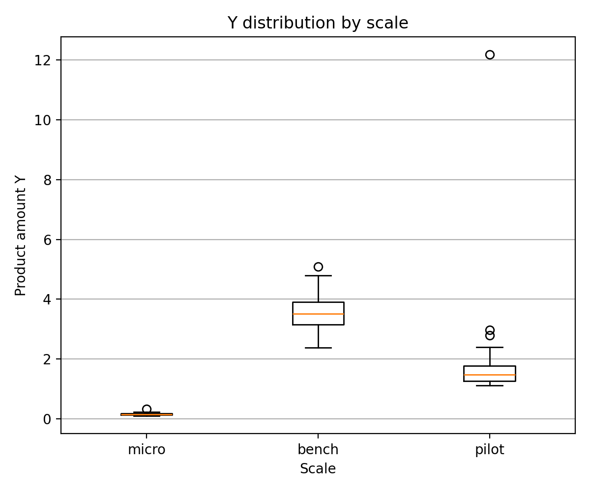
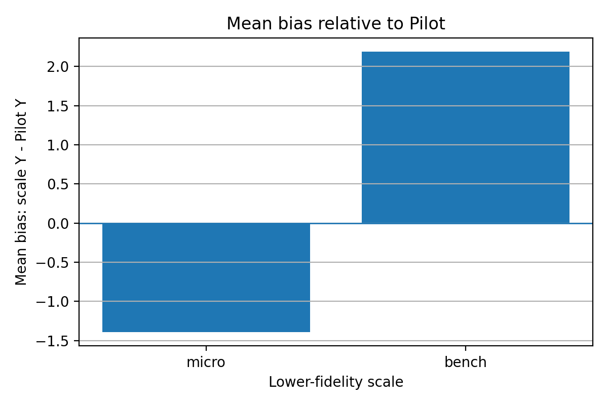
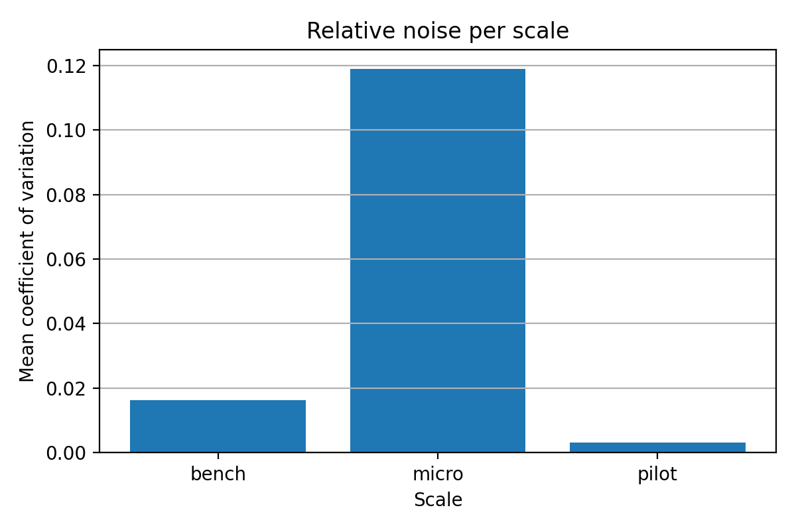
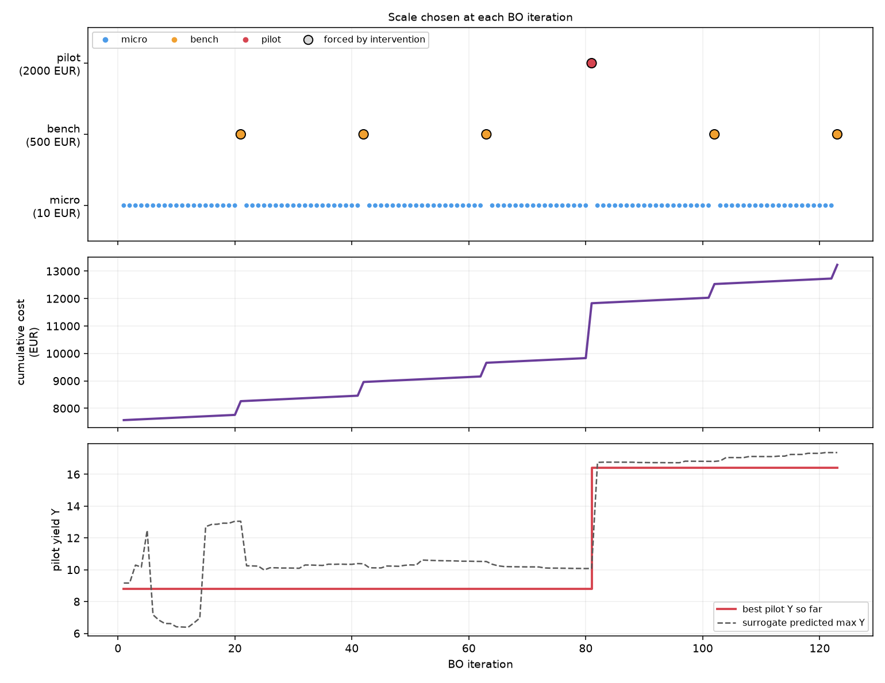

# Multi-Fidelity Bayesian Optimization of a Bioprocess

A simulation-based study of **cost-aware experimental design** for maximizing bioprocess product yield across three reactor scales. The project combines exploratory data analysis, noise/bias characterization, multi-fidelity Gaussian Process (GP) surrogate modelling, and Bayesian optimization under a **€15,000 experimental budget**.

> **Reproducibility:** The included analysis data and plots can be inspected without the course simulator. Running live optimization scripts requires authorized access to the original simulator API; its availability and permissions are not guaranteed. This repository is a research/coursework archive, not an independently verified production package.

## Problem and setup

A recipe contains five controllable variables: **temperature T (20–60 °C)**, **pH (3–9.5)**, and **glucose F1, glutamine F2, and rich-media F3 feed rates (0–2 g/L/h each)**. The optimization target is the final product amount **Y at pilot scale**, using cheaper observations to inform expensive experiments.

| Fidelity | Experiment cost | Role |
|---|---:|---|
| Microplate | €10 | Low-cost search/exploration |
| Benchtop | €500 | Intermediate confirmation |
| Pilot | €2,000 | High-fidelity target evaluation |

Fidelity responses have different scales and systematic offsets; lower-fidelity outputs are **not direct estimates of pilot yield**.

## Methodology

1. **Exploratory analysis:** study product yield against T, pH, F1–F3 using 120 visualisation experiments (40 per scale).
2. **Noise and bias:** analyze 16 recipes repeated 10 times per scale (160 experiments per scale); estimate recipe-wise standard deviation, coefficient of variation and average bias relative to Pilot.
3. **Multi-fidelity GP:** use BoTorch `SingleTaskMultiFidelityGP`, combining a recipe-space kernel and a fidelity kernel; normalize targets separately by scale to address differing magnitude ranges.
4. **Cost-aware sequential design:** use `qMultiFidelityKnowledgeGradient` and inverse-cost-weighted utility to select recipes and fidelity. Additional rules trigger higher-fidelity checks after long runs at cheaper scales.
5. **Comparative analysis:** compare with non-adaptive Sobol / Latin Hypercube baselines and investigate per-fidelity selection and Sobol sensitivity.

## Results reported in the team report

- Mean coefficient of variation in repeated measurements: **Microplate ~0.119**, **Benchtop ~0.016**, **Pilot ~0.003**; the microplate scale has the greatest *relative* measurement noise.
- Mean bias relative to Pilot at matched recipes: **Microplate −1.391**, **Benchtop +2.188** in reported product-amount units.
- The report's comparison table gives **mean performance 19.5232** for the Bayesian optimization setup versus **6.17 (Sobol)** and **4.1476 (Latin Hypercube)**, with a reported **peak 21.724 g/L**. These are *simulator / evaluation* results under the report's comparison protocol, not externally validated process outcomes.
- A separate logged sequential campaign is analyzed in the report as **117 Microplate, 5 Benchtop, and 1 Pilot** evaluations over 123 iterations. Do not treat this log as an identical evaluation protocol to the baseline comparison.

## Visualizations

### Product distribution by reactor scale


### Bias relative to pilot scale


### Relative measurement noise


### Fidelity-selection analysis


## Repository guide

| Path | Contents |
|---|---|
| `visualization_and_bias.py` | EDA, repeatability/noise, scale bias, charts and summary tables |
| `main.py` | Main GP-based cost-aware Bayesian optimization campaign (live API required) |
| `mfbo_v1.py` | Earlier multi-fidelity optimization variant (live API required) |
| `basic_client.py` | Course simulator HTTP API session client |
| `non_adaptive.py` | Non-adaptive baseline sampling / evaluation (live API required) |
| `evaluate_results.py` | Saved campaign evaluation / model plots; currently includes live API setup |
| `random_forest_bo.py`, `independent_gp_bo.py` | Experimental comparison scripts; **not standalone** in the supplied archive, because they import missing `data_utils.py` and/or `independent_gp.py` |
| `Sensitivity_analysis.py`, `task5_sensitivity.py` | Sensitivity-analysis experiments and supporting calculations |
| `task4_scale_selection.py` | Fidelity selection analysis |
| `results/` | Saved data tables, optimization log and figures |
| `MLME_Project_Report.pdf` | Team project report (include publicly only with permission) |

**Archive limitations:** The supplied ZIP does not contain the `task3_pilot_vs_multiscale.py` script mentioned in its original README, and some comparison scripts depend on files absent from the archive. No end-to-end execution or API connectivity has been verified in this packaging step.

## Installation

Python **3.11** is recommended based on the source repository README.

```bash
python -m venv .venv
# Linux/macOS:
source .venv/bin/activate
# Windows PowerShell:
# .venv\Scripts\Activate.ps1
pip install -r requirements.txt
```

The dependency list is derived from imports and is **not a tested pinned environment**. Some versions of BoTorch, GPyTorch, PyTorch and SALib may need adjustment for compatibility.

### Reproduce offline exploratory analysis

```bash
python visualization_and_bias.py
```

This script reads the existing files under `results/` and recreates the Task 1/2 plots and tables; it does not need simulator credentials. Its outputs write into the existing results directories.

### Live simulator-dependent campaigns (restricted)

The original scripts are designed to call a remote course simulator and can expend experimental budget. **Do not run them without course authorization and a deliberate budget check.** Credentials have been removed from this review copy. Configure environment variables `MLME_USER`, `MLME_PASSWORD`, `MLME_BASE_URL` for an authorized environment. Example:

```bash
# Only after verifying authorization and simulator availability
# python main.py
```

Some scripts authenticate on import, so avoid importing/running them casually. Existing historical artifacts are sufficient to browse the project without API access.

## Contributions and acknowledgement

Team project by **Gautam Singh Chauhan, Sai Vamsi Kuna, Dharnish Kumar Vasudevan Giri, and Janis Weber**. The report attributes the **project overview, data exploration, and scale-dependent noise/bias analysis** to **Sai Vamsi Kuna**; the **multi-fidelity BO methodology and baseline evaluation** to **Janis Weber**; and additional exploration / sensitivity and scale-selection work to other team members. Full details appear in `MLME_Project_Report.pdf`.

## Publication and integrity

- Obtain permission to share team source code, report, and course-generated data.
- **Rotate/revoke the credentials embedded in the original ZIP**, even though they are not included here.
- Do not push the original archive or any earlier Git history containing those credentials.
- Check scripts and data for other non-public information; this review copy is not a legal/security audit.
- Confirm external simulator usage terms before exposing API-specific code or access URLs.
- Add a `LICENSE` file only when all rights holders agree on a license. **No license is granted by default.**
